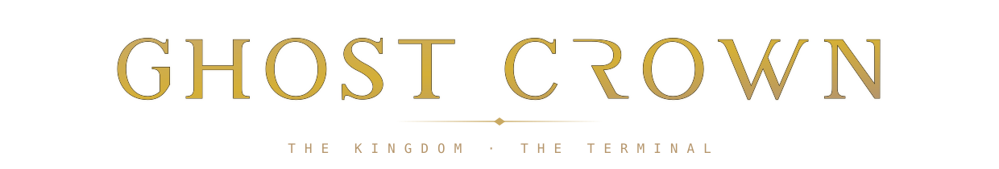

<!--
  ┌─────────────────────────────────────────────────────────────────────┐
  │  GENERATED FILE — do not edit this README by hand.                  │
  │  Edit  data/profile.json · data/properties.json · the template,     │
  │  then run:   node scripts/build-profile.mjs                         │
  │  (the GitHub Action rebuilds it automatically on push to main).     │
  └─────────────────────────────────────────────────────────────────────┘
-->

<div align="center">



<em>The Ghost Kingdom — the club, the cameras, the terminal, under one crown.</em>


<table>
  <tr>
    <td align="center" width="430" valign="top">
      <br/>
      <br/>
      <sub>PRODUCER · ENGINEER · THE ONE WHO SHIPS</sub>
    </td>
    <td align="center" width="430" valign="top">
      <br/>
      <br/>
      <sub>CHIEF QUALITY BENGAL · STUDIO ENFORCER</sub>
    </td>
  </tr>
</table>


### The roster

| Property | Type | Live at | Status | Build |
|:--|:--|:--|:--:|:--:|
| **Ghost Kingdom** | Camera fleet | [ghostk.ing ↗](https://www.ghostk.ing) | 🟢 Live | `GHOST-CAM` |
| **The Kingdom** | Docs + club | kingdom club | 🔵 Soon | `KINGDOM` |
| **The Terminal** | Terminal | kingdom terminal | 🔵 Soon | `TERMINAL` |

<sub>🟢 Live&nbsp;&nbsp;·&nbsp;&nbsp;🔵 Soon&nbsp;&nbsp;—&nbsp;&nbsp;names link to the live site.</sub>

<br/>

```text
╔════════════════════════════════════════════╗
║   THE KINGDOM · THE TERMINAL · THE CROWN   ║
║      BUILT IN THE DARK · WORN AS FOIL      ║
╚════════════════════════════════════════════╝
```

<br/>


<sub>GHOST CROWN · A SAVAGE HOUSE</sub>

<sub><a href="https://github.com/savageceo">SAVAGE CEO</a>&nbsp;&nbsp;·&nbsp;&nbsp;<a href="https://github.com/SAVAGE-STUDIO-INC">SAVAGE STUDIO</a>&nbsp;&nbsp;·&nbsp;&nbsp;<a href="https://github.com/SAVAGE-ROSTER">SAVAGE ROSTER</a>&nbsp;&nbsp;·&nbsp;&nbsp;<a href="https://github.com/SAVAGE-SUITE">SAVAGE SUITE</a>&nbsp;&nbsp;·&nbsp;&nbsp;<a href="https://github.com/SAVAGE-CITY">SAVAGE CITY</a>&nbsp;&nbsp;·&nbsp;&nbsp;<a href="https://github.com/SAVAGE-BUNNY">SAVAGE BUNNY</a>&nbsp;&nbsp;·&nbsp;&nbsp;<a href="https://github.com/SAVAGE-CLIENTS">SAVAGE CLIENTS</a>&nbsp;&nbsp;·&nbsp;&nbsp;<b>GHOST CROWN</b></sub>

<p>
  <a href="https://github.com/GHOST-CROWN"></a>
</p>

</div>
