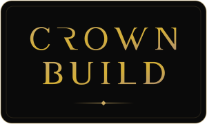
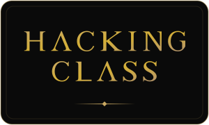
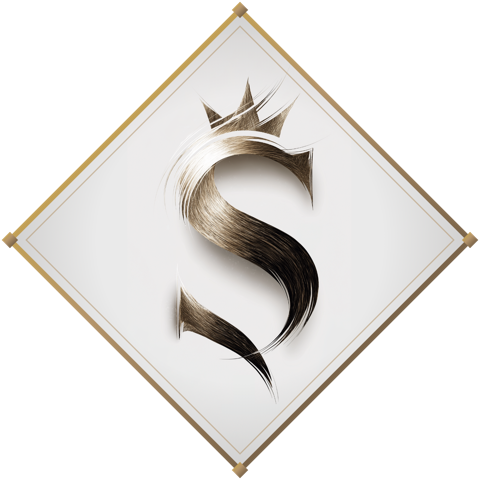

<!--
  ┌─────────────────────────────────────────────────────────────────────┐
  │  GENERATED FILE — do not edit this README by hand.                  │
  │  Edit  data/profile.json · data/properties.json · the template,     │
  │  then run:   node scripts/build-profile.mjs                         │
  │  (the GitHub Action rebuilds it automatically on push to main).     │
  └─────────────────────────────────────────────────────────────────────┘
-->

<div align="center">


<em>The Ghost Kingdom — the club, the cameras, the terminal, under one crown.</em>


<p></p>

<table>
  <tr>
    <td align="center" valign="top" width="220">
      <a href="https://www.ghostk.ing"></a><br/>
      <sub>Camera fleet</sub>
    </td>
    <td align="center" valign="top" width="220">
      <br/>
      <sub>Docs + club</sub>
    </td>
    <td align="center" valign="top" width="220">
      <br/>
      <sub>Site build</sub>
    </td>
    <td align="center" valign="top" width="220">
      <br/>
      <sub>Certification path</sub>
    </td>
  </tr>
</table>


### The crown

| Build | What | Live at | Status | Repo |
|:--|:--|:--|:--:|:--:|
| **Ghost Kingdom** | Camera fleet | [ghostk.ing ↗](https://www.ghostk.ing) | 🟢 Live | `GHOST-CAM` |
| **The Kingdom** | Docs + club | kingdom club | 🔵 Soon | `KINGDOM` |
| **Crown Build** | Site build | the crown site | 🔵 Soon | `CROWN-BUILD` |
| **Hacking Class** | Certification path | pentest path | 🔒 Private | `ghostcrown.lol` |

<sub>🟢 Live&nbsp;&nbsp;·&nbsp;&nbsp;🔵 Soon&nbsp;&nbsp;·&nbsp;&nbsp;🔒 Private&nbsp;&nbsp;—&nbsp;&nbsp;names link to the live site.</sub>

<br/>

```text
$ cat LAW
› THE KINGDOM · THE TERMINAL · THE CROWN
› BUILT IN THE DARK · WORN AS FOIL
$ █
```

<br/>



<sub>GHOST CROWN · A SAVAGE HOUSE</sub>

<sub><a href="https://github.com/savageceo">SAVAGE CEO</a>&nbsp;&nbsp;·&nbsp;&nbsp;<a href="https://github.com/SAVAGE-STUDIO-INC">SAVAGE STUDIO</a>&nbsp;&nbsp;·&nbsp;&nbsp;<a href="https://github.com/SAVAGE-ROSTER">SAVAGE ROSTER</a>&nbsp;&nbsp;·&nbsp;&nbsp;<a href="https://github.com/SAVAGE-SUITE">SAVAGE SUITE</a>&nbsp;&nbsp;·&nbsp;&nbsp;<a href="https://github.com/SAVAGE-CITY">SAVAGE CITY</a>&nbsp;&nbsp;·&nbsp;&nbsp;<a href="https://github.com/SAVAGE-BUNNY">SAVAGE BUNNY</a>&nbsp;&nbsp;·&nbsp;&nbsp;<a href="https://github.com/SAVAGE-CLIENTS">SAVAGE CLIENTS</a>&nbsp;&nbsp;·&nbsp;&nbsp;<b>GHOST CROWN</b></sub>

<p>
  <a href="https://github.com/GHOST-CROWN"></a>
</p>

</div>
